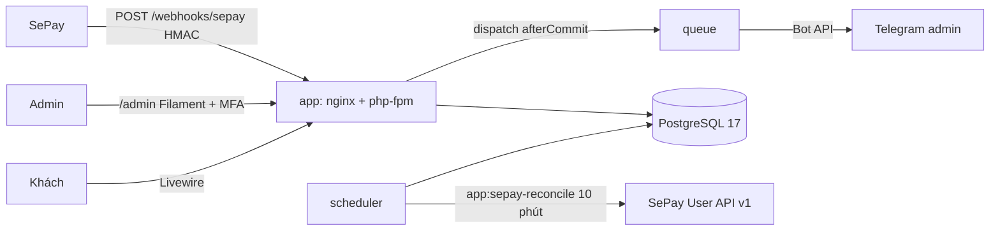

# Kiến trúc hệ thống — SMM Panel

Trạng thái: giai đoạn 1 đã triển khai code · Cập nhật: 2026-11-14. Vận hành: [deployment.md](./deployment.md) · Quyết định công nghệ: [tech-stack.md](./tech-stack.md) · Cây thư mục: [codebase-summary.md](./codebase-summary.md).

## 1. Thành phần

| Thành phần | Công nghệ / vị trí | Ghi chú |
|---|---|---|
| Trang khách | Livewire 4 + Blade: `CustomerDashboard` (`/`), `PlaceOrder` (`/dat-don`), `MyOrders` (`/don-hang`), `Deposit` (`/nap-tien`), `ChatWidget` | Route trong `routes/web.php`, nhóm `auth`. `MyOrders` poll 30s, chat poll 5s (mở) / 20s (đóng), đều `.visible` |
| Auth khách | Fortify (route tự khai, `Fortify::ignoreRoutes()`) + Socialite Google | Limiter riêng: `login` 5/phút (email+IP), `register` 5, `forgot` 3, `oauth` 10 (theo IP) |
| Admin | Filament 5, path `/admin`, `AdminPanelProvider` | Resource/Page tự phát hiện trong `app/Filament`; MFA TOTP bắt buộc; chỉ sáng |
| Webhook | `routes/webhooks.php` → `SepayWebhookController`, middleware `VerifySepaySignature` | Ngoài nhóm `web` (không session/CSRF), `throttle:120,1` |
| Queue | Driver `database`, container `queue` (`queue:work`) | Hiện chỉ job `SendTelegramMessage` |
| Scheduler | Container `scheduler` (`schedule:work`), `routes/console.php` | `app:sepay-reconcile` mỗi 10 phút; `queue:prune-failed --hours=168` hằng ngày; `auth:clear-resets` mỗi 15 phút |
| Telegram | `AdminNotifier` → job `SendTelegramMessage` (`afterCommit`) | Token/chat id lưu ở `TelegramSettings` (token mã hoá). Rollback transaction → không gửi |
| Health | `/up` | Caddy/compose dùng kiểm sống |
| Cấu hình runtime | `App\Support\RuntimeConfig::apply()` đầu `AppServiceProvider::boot()` | Đè `config()` từ nhóm settings `general`/`integrations` mỗi request/job (xem 2.1). Bỏ qua trong `migrate*`, `config:cache|clear`, `optimize*`, `package:discover`, `settings:*`, `filament:upgrade` |
| Cổng tính năng | Middleware `ensure.feature:registration|google_login`, `customer.maintenance` | Route khai tĩnh (tương thích `route:cache`); tắt đăng ký/Google → 404; bảo trì → 503 chỉ trang khách (không gồm `/admin`, webhook, `/up`) |
| Cài đặt lần đầu | `EnsureInstalled` (nhóm `web` + middleware panel `/admin`), wizard `App\Livewire\Install\InstallWizard` tại `/install`, `App\Support\InstallState`, settings `install.installed_at` | Chưa cài → mọi route web + `/admin` về `/install` (ngoại lệ: `install`, `default-livewire.update`, `livewire.*`, `locale.update`, `/up`, `/webhooks/*`). Cờ đọc thẳng DB mỗi request. Wizard đòi `INSTALL_TOKEN` (`hash_equals`), `finish()` trong transaction + `pg_advisory_xact_lock`; đã cài → `/install` và mọi action Livewire của wizard 404. Migration tự đánh dấu đã cài nếu đã có admin |
| Giao diện khách | `App\Support\Branding` + component `theme-head`/`theme-body` | In màu chính, favicon, custom CSS/head/body CHỈ khi người xem không phải admin (cùng origin + cookie với `/admin`) |

Mọi thay đổi tiền đi qua `app/Services/*`; Livewire/Filament chỉ gọi service, không tự ghi `users.balance`.

## 2. Mô hình dữ liệu

Tiền: số nguyên VND (`bigInteger`), không có số thực.

| Bảng | Cột / ràng buộc chính |
|---|---|
| `users` | `balance`, `total_deposited` (CHECK `>= 0`); `tier` (CHECK `member`/`agency`), `tier_manual`, `tier_changed_at`; `deposit_code` (unique, NOT NULL, dạng `BP` + 6 ký tự); `google_id` (unique), `password` nullable; `is_admin`, `locked_at`; `app_authentication_secret`, `app_authentication_recovery_codes` (MFA) |
| `wallet_transactions` | Sổ cái **append-only**: trigger `wallet_tx_no_update_delete` chặn UPDATE/DELETE. `amount` có dấu (CHECK `<> 0`), `balance_after` (CHECK `>= 0`), `idempotency_key` **unique**, `type` CHECK (`topup`, `bonus`, `order`, `refund`, `adjust`, `topup_reversal`, `bonus_reversal`), `reference` morph, `created_by` |
| `categories` | Nền tảng: `name`, `slug` unique, `badge`, `color`, `sort_order`, `is_active` |
| `services` | `category_id`, `unit` (`per_1000`/`per_unit`), `price`, `min_quantity`, `max_quantity`, `speed`, `start_time`, `is_active`, `sort_order` |
| `orders` | Snapshot lúc đặt: `service_name`, `unit`, `unit_price`, `discount_percent`; `quantity`, `done`, `total`, `status` (`pending`/`processing`/`completed`/`refunded`), `refunded_amount`, `refunded_at`. CHECK: `quantity > 0`, `0 <= done <= quantity`, `total >= 0` |
| `bank_transactions` | `sepay_id` **unique**; `source` (`webhook`/`reconcile`/`manual`); `transfer_type` (`in`/`out`); `transfer_amount > 0`; `status` (`pending`/`credited`/`unmatched`/`ignored`); `reference_code` (index); `payload` jsonb; `bonus_percent` chốt lúc nhận; `bonus_amount`; `assignment_no`; `user_id`, `assigned_by`. Không bao giờ xoá |
| `chat_threads` / `chat_messages` | Mỗi khách đúng 1 thread (`user_id` unique); `customer_last_read_id`, `admin_last_read_id`, `admin_notified_at`; tin có `sender_type` CHECK (`customer`/`admin`) |
| `notices` | Thông báo bảng điều khiển khách: `title`, `body` (chữ thuần), `is_published`, `published_at` |
| `admin_audit_logs` | `admin_id`, `action`, `subject` morph, `changes` jsonb (`before`/`after`), `ip`, `created_at` |
| `settings` | spatie/laravel-settings, 7 nhóm: `general` (tên site, logo, favicon, liên hệ, locale mặc định, SEO), `access` (đăng ký, Google, 2FA khách, bảo trì), `appearance` (màu chính, custom CSS/HTML), `integrations` (SMTP, Google, SePay; `smtp_password`, `google_client_secret`, `sepay_webhook_secret`, `sepay_api_token` mã hoá), `deposit` (BIN, tên NH, STK, tên TK, `bonus_rules`), `tier` (`agency_threshold`, `agency_discount_percent`, `member_discount_percent`), `telegram` (`enabled`, `bot_token` mã hoá, `chat_id`) |
| `cache`, `jobs`, `sessions`... | Driver `database` cho cache/queue/session |

### 2.1 Quy ước settings

- **Mọi property của một settings class PHẢI có giá trị mặc định PHP** (`public bool $x = true;`, `public ?string $y = null;`). Instance cũ chưa có dòng trong bảng `settings` khi nâng cấp sẽ được `SettingsMapper` tự điền mặc định thay vì ném `MissingSettings` làm crash boot/`migrate`. Mặc định của giá trị "đè `.env`" phải là rỗng (`''`/`null`) để không đè nhầm `.env`.
- Settings migration của nhóm tích hợp **không seed từ `.env`**: DB rỗng = `.env` áp dụng. Chỉ seed giá trị không nhạy cảm (`site_name`, `default_locale`).
- Thứ tự ưu tiên: DB (khác rỗng) > `.env`. Settings cache của spatie giữ tắt (`SETTINGS_CACHE_ENABLED` không đặt): cache không TTL, không tự xoá khi migrate; 4 truy vấn PK/request là rẻ.
- Locale mặc định của site ở `config('app.default_locale')` (không dùng `app.locale`, vì `setLocale()` ghi đè nó theo từng request).
- Mỗi settings class mới nên có test kiểu `SettingsUpgradeTest`: xoá dòng của nhóm, đọc + `artisan migrate` vẫn chạy.

## 3. Dòng tiền

Mọi thay đổi số dư đi qua `WalletService::apply()`: transaction → `SELECT … FOR UPDATE` dòng user → tra `idempotency_key` → tính số dư → ghi sổ cái → cập nhật `users`. Trùng key: cùng user/số tiền/loại thì trả bản cũ, khác thì ném `IdempotencyConflict`.

### 3.1 Đặt đơn (`OrderService::place`)

1. Khoá user → từ chối nếu bị khoá → lấy dịch vụ đang bật → validate link http(s), số lượng min/max.
2. Giá tính ở server: `PricingService::total(price, unit, qty, discount%)` với `%` theo cấp (`TierService::discountPercent`); lưu snapshot vào đơn.
3. Tạo đơn rồi `debit` key `order:{orderId}`. Thiếu tiền → `InsufficientBalance` → rollback cả đơn.

### 3.2 Hoàn tiền (`OrderService`, chuyển trạng thái `Refunded`)

- Khoá đơn (kiểm `expected status/done` → `StaleOrderState` nếu đã đổi), tính `PricingService::refundAmount(total, qty, done)`, cập nhật đơn, `credit` loại `refund` key `refund:order:{orderId}` → mỗi đơn hoàn tối đa một lần (số tiền 0 thì không ghi sổ). Hoàn từ `completed` bắt buộc lý do và `done` thực tế < `quantity`.

### 3.3 Nạp tiền SePay (`DepositService`)

Webhook, đối soát (`source=reconcile`) và nhập tay (`source=manual`) cùng đi qua `handleWebhook()`:

1. `INSERT … ON CONFLICT DO NOTHING` theo `sepay_id` (trùng → `duplicate`, HTTP vẫn 200).
2. Khoá `bank_transactions` rồi xử lý theo thứ tự: `transfer_type != in` → `ignored`; sai STK nhận (khi đã cấu hình) → `unmatched`; **nghi trùng** → `unmatched` + Telegram; không tìm ra khách theo `DepositCodeMatcher` (`code` rồi `content`) → `unmatched`; còn lại → `credited`.
3. **Chống cộng 2 lần đa nguồn** (`sameBankReference`): `pg_advisory_xact_lock(hashtext('bank-ref:{reference_code}'))`, rồi nếu có giao dịch khác (khác `id`) cùng `reference_code` + số tiền + loại thì giữ `unmatched`, ghi chú "Nghi trùng", báo Telegram. Khoá advisory để hai bản về song song khác `sepay_id` không cùng lọt qua bước kiểm.
4. Ghi sổ: `topup` key `sepay:{sepay_id}:{n}`; nếu `bonus_percent` > 0 thì `bonus` key `sepay-bonus:{sepay_id}:{n}` (`n = assignment_no + 1`). Sau đó `TierService::promoteIfEligible`.

Gán tay / huỷ gán:

| Thao tác | Điều kiện | Kết quả |
|---|---|---|
| `assign` | `in` và `unmatched`/`ignored` (`ignored` cần xác nhận → `ConfirmationRequired`); không gán cho admin | Cộng `topup` (+ `bonus` theo `%` đã chốt), tăng `assignment_no`, audit `deposit.assign`. Đã xử lý → `DepositAlreadyProcessed` |
| `unassign` | `credited`, bắt buộc lý do | Trừ `topup_reversal` key `sepay-reversal:{id}:{n}` (+ `bonus_reversal` key `sepay-bonus-reversal:{id}:{n}`), về `unmatched`; thiếu số dư → từ chối toàn bộ; không tự hạ cấp. Gán lại dùng `n+1` nên không đụng key cũ |
| `ignore` | `unmatched` | Chuyển `ignored` + audit |
| `importManual` | Admin nhập `sepay_id`, số tiền, nội dung, ngày, mã tham chiếu | Đi `handleWebhook(…, 'manual')` + audit + Telegram |

Điều chỉnh số dư thủ công (`UserAdminService::adjustBalance`): lý do bắt buộc, admin không tự điều chỉnh mình (`SelfAdjustmentForbidden`), key `adjust:{uuid}` sinh lúc mở modal. **Không dùng để bù tiền nạp** (sẽ cộng đôi khi webhook/đối soát về).

### 3.4 Đối soát

`app:sepay-reconcile [--from=] [--to=]` (mặc định 3 ngày gần nhất) → `SepayReconciler` → `SepayApiClient` → từng giao dịch qua `handleWebhook(…, 'reconcile')`. Lỗi một dòng không chặn cả lô; có lỗi thì báo Telegram tối đa 1 lần/giờ. Nút "Đối soát" và "Nhập giao dịch thủ công" ở trang `BankTransactionResource`.

## 4. Quy ước khoá (lock ordering)

1. Khoá thực thể nghiệp vụ **trước** (`orders`, `bank_transactions`), khoá `users` **sau** (qua `WalletService`).
2. Ngoại lệ có chủ đích: `OrderService::place` khoá user **trước** khi INSERT đơn, vì INSERT có FK tới `users` lấy KEY SHARE; khoá sau sẽ deadlock khi đặt song song.
3. Khoá advisory theo mã tham chiếu lấy sau khi đã khoá `bank_transactions`.
4. Transaction đặt đơn / chuyển trạng thái đơn dùng `attempts: 3` để thử lại khi deadlock.

## 5. Bảo mật

| Lớp | Cơ chế |
|---|---|
| Webhook | HMAC-SHA256 `X-SePay-Signature: sha256=<hex>` trên `"{timestamp}.{raw_body}"`, `X-SePay-Timestamp` lệch tối đa 300 giây (`config/sepay.php`). Không có nhánh API key. Thiếu `SEPAY_WEBHOOK_SECRET` → 503 (fail closed) + Telegram ≤ 1 lần/giờ. Sai chữ ký/giờ → 401; ≥ 10 lần/10 phút → Telegram. IP ngoài allowlist chỉ log cảnh báo, không chặn |
| Admin | `canAccessPanel` = `is_admin` và chưa bị khoá; MFA TOTP bắt buộc (`isRequired: true`, kèm recovery codes); `/login` từ chối admin ("đăng nhập tại /admin") để không né MFA; Google login cũng chặn admin |
| Khách | Tài khoản bị khoá không đăng nhập được; đang đăng nhập thì `EnsureAccountNotLocked` đăng xuất ở request kế; không đặt đơn được; vẫn nhận tiền nạp |
| Truy vấn | `MyOrders`/`Deposit` luôn lọc theo `auth()->id()`; không có `OrderPolicy` (YAGNI) |
| Sổ cái | Trigger append-only, CHECK không âm, idempotency key unique, `SELECT … FOR UPDATE` |
| Audit | `AuditLog::record` ghi `admin_audit_logs` (admin, hành động, đối tượng, before/after, IP) cho gán/huỷ gán/bỏ qua/nhập tay giao dịch, điều chỉnh số dư, khoá/mở khoá, đổi cài đặt (`AuditsSettingsChanges`) |
| Cài đặt nhạy cảm | `bot_token`, `smtp_password`, `google_client_secret`, `sepay_webhook_secret`, `sepay_api_token` mã hoá trong `settings`, không vào `config:cache`; audit chỉ ghi "đã đổi"; `APP_KEY` mã hoá cả secret MFA |

## 6. Phụ thuộc ngoài

| Dịch vụ | Dùng cho | Cấu hình |
|---|---|---|
| SePay webhook | Nhận tiền nạp | `SEPAY_WEBHOOK_SECRET` |
| SePay User API (legacy v1) | Đối soát | `SEPAY_API_TOKEN`, `SEPAY_API_URL` |
| `img.vietqr.io` | Ảnh QR (`App\Support\VietQr`) | Từ `DepositSettings` |
| Telegram Bot API | Báo admin | `TelegramSettings` (trang Telegram trong admin) |
| Google OAuth, SMTP | Đăng nhập Google, quên mật khẩu | `GOOGLE_*`, `MAIL_*` |
